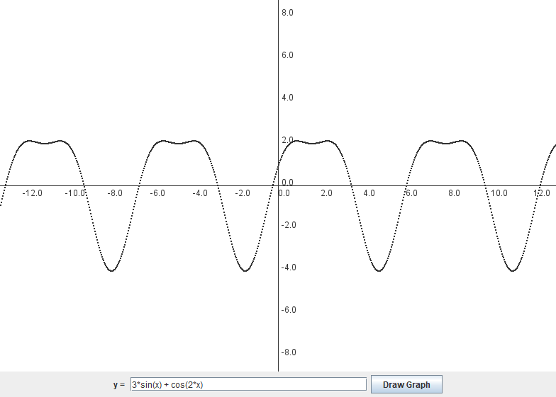

# WolframBeta

A function grapher built from scratch in Java Swing. Type an expression in `x` and the graph redraws as you type. The tokenizer, parser and expression tree are all hand-written, with no math or parsing libraries.



## Features

- **Live graphing.** The curve redraws on every keystroke. While the input doesn't parse yet (say, halfway through typing `sin(`), the last valid graph stays on screen.
- **Zoom** with the mouse wheel. Axis labels keep a readable 1, 2, 5 spacing at any zoom level.
- **Syntax:**

  | Type | Syntax |
  |---|---|
  | Numbers | `2`, `0.5` |
  | Variable | `x` |
  | Operators | `+` `-` `*` `/` `^` (`^` is right-associative: `2^3^2` is 512) |
  | Functions | `sin`, `cos`, `tan` |
  | Grouping | parentheses and unary `+`/`-` |

  Write multiplication explicitly: `2*x`, not `2x`.

## How it works

The input goes through three stages: text to tokens, tokens to a tree, and the tree to points on the screen. For `3*sin(x) + cos(2*x)`, the parser builds this tree:

```
         +
       /   \
      *     cos
     / \     |
    3  sin   *
        |   / \
        x  2   x
```

- **`Tokenizer`** splits the input into numbers, operators, parentheses, the variable `x` and function names, and rejects anything else.
- **`Parser`** is a recursive-descent parser with one method per precedence level: `parseExpression` (`+ -`), `parseTerm` (`* /`), `parsePower` (`^`, right-associative) and `parseFactor` (numbers, `x`, parentheses, function calls and unary signs).
- **The tree nodes** (`NumberNode`, `variableNode`, `BinaryOpNode`, `FunctionNode`) each implement `evaluate(x)`, so evaluating the whole expression is one call on the root.
- **`GraphPanel`** turns each pixel column into an `x` value, evaluates the tree there and plots the point. Each scroll-wheel notch changes the scale by 20%.

## Running

With JDK 22 or newer, one command compiles and starts it:

```bash
java src/WolframBeta.java
```

With an older JDK (8 or newer), compile first:

```bash
javac -d out src/*.java
java -cp out WolframBeta
```

## Limitations

- The view is always centered on the origin; there's no panning yet.
- The curve is drawn as one point per pixel column, so very steep sections look dotted.
- No constants like `pi` or `e`, and no functions beyond `sin`, `cos` and `tan`.
